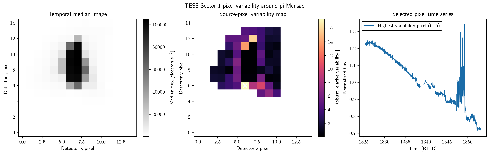

# gordion

## Introduction
Gordion is a TESS Full-Frame Image (FFI) variability analysis workflow. It is designed to characterize pixel-level variability in large image stacks and to expose the relevant image, catalog, and diagnostic products in a reproducible scientific workflow.

## Scientific scope
- FFI-based variability detection and summary products for TESS data.
- Pixel-level processing and diagnostics for image-centric analyses.
- Reusable image and catalog plotting helpers rooted in the shared tdpy utility layer.
- Workflow orchestration for data products that are intended to be inspected and validated before downstream modeling.

## Active package API
The maintained scientific entry points live under the package directory and are imported through `gordion` and `gordion.main`.

The project is organized around the convention that reusable functionality stays in the library and that task-specific orchestration remains in the workflow layer, with plotting and diagnostics available for input, intermediate, and output products.

## Installation

```bash
python -m pip install -e .
export GORDION_PATH=/path/to/gordion
```

`GORDION_PATH` identifies the repository root. Keep runtime inputs in `data/` and generated pipeline outputs in `visuals/`; both directories are ignored by Git.

## Data and diagnostics
The workflow is intended to operate on environment-configured data directories rather than workstation-specific absolute paths. The primary outputs are diagnostic plots and derived image or catalog products that can be inspected after execution.

## Public TESS example

The runnable example retrieves the public TESS Sector 1 cutout around $\pi$ Mensae from the Mikulski Archive for Space Telescopes and passes the observed flux cube through Gordion's pixel-variability pipeline:

```bash
python examples/tess_pixel_variability.py --typefileplot png
```



The temporal median image shows the observed scene. The robust relative-scatter map identifies the detector pixel with the strongest variability, and the final panel exposes that pixel's normalized time series. The figure contains public TESS measurements rather than simulated observations.

## Status
This repository remains an active scientific tool, but its code should be treated as workflow-oriented rather than as a broad generic package. The safest usage pattern is to import the package and use the exported functions and workflow entry points rather than depending on older prototype code in legacy directories.
