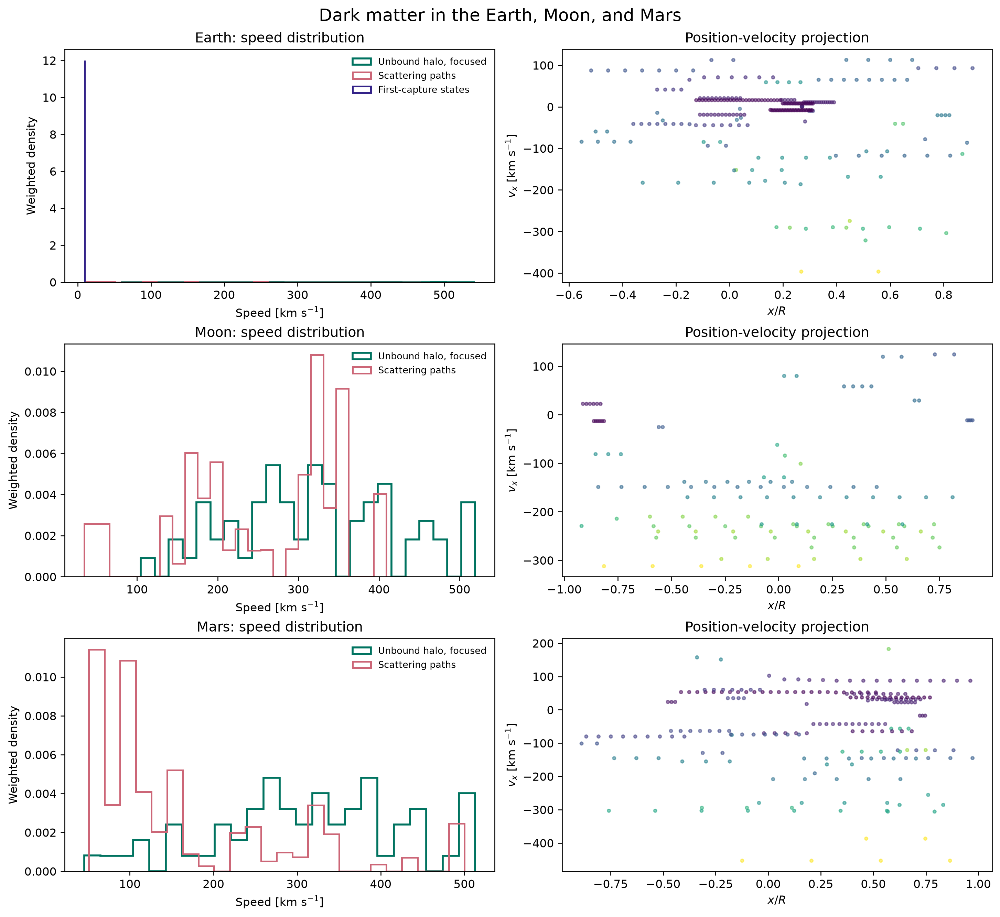
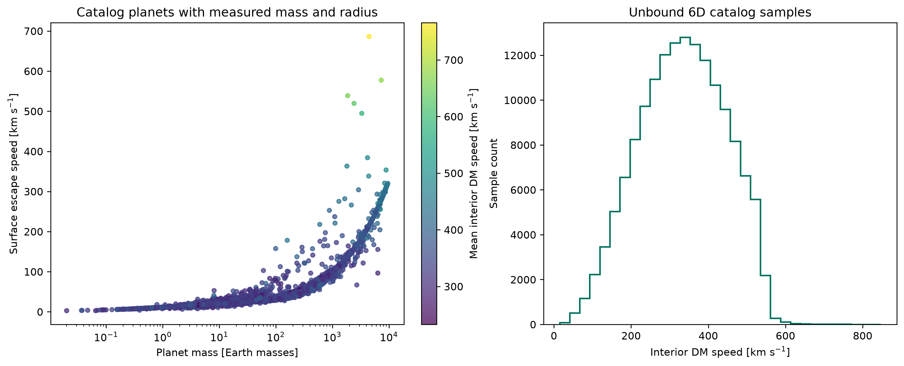
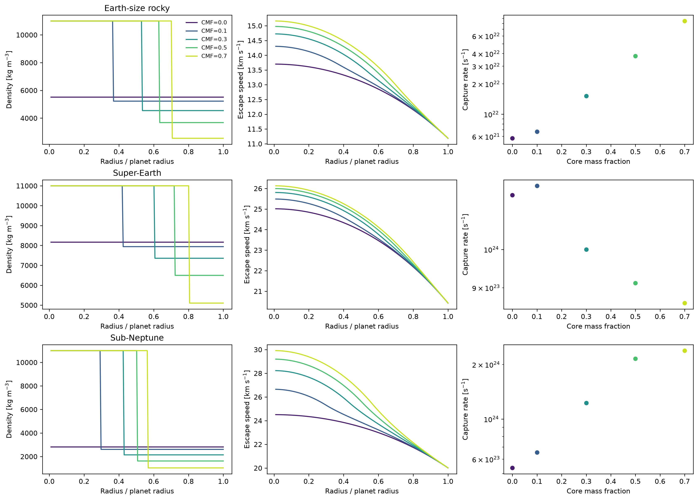
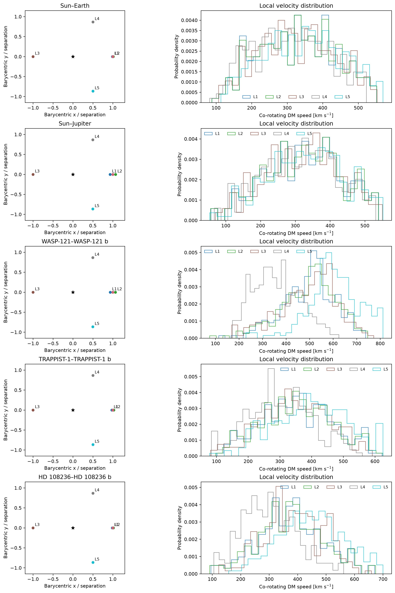
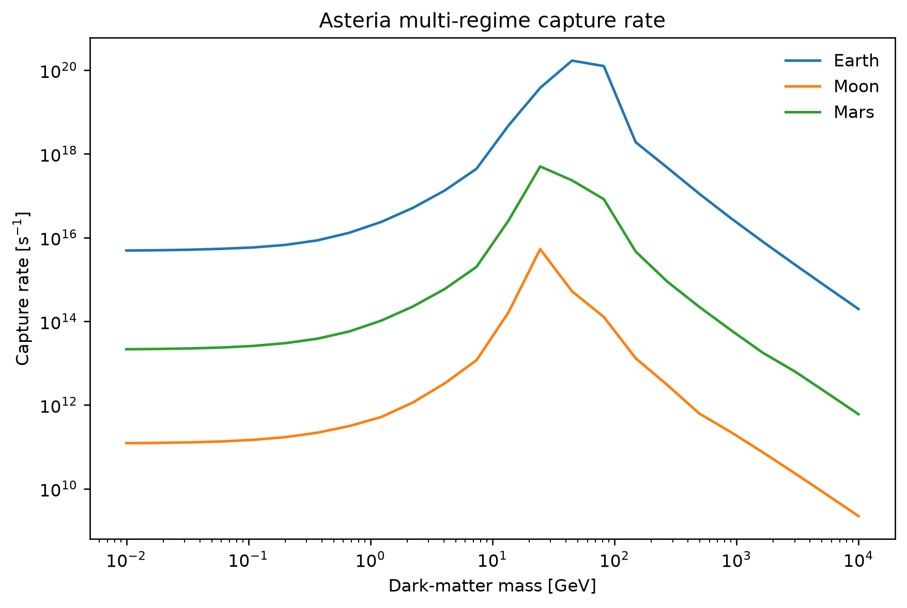

# Gordion

Capturing dark matter can take many collisions, and the motion after each one
matters. I use Gordion to calculate capture across interaction regimes and sample
the resulting phase space in modeled celestial bodies. Its capture model follows the
multi-regime treatment of Leane & Smirnov (2023), also released as Asteria.
Around that core, Gordion provides layered body profiles, elastic-scattering
trajectories, weighted six-dimensional samples, and co-rotating Lagrange-point
distributions.

The library, planetary examples, and notebook run without Asteria. Only the
optional benchmark comparison imports it.

Gordion follows particles through spherical gravity and samples isotropic
elastic scattering on stationary nuclei. Earth, Moon, and Mars use explicit
piecewise-uniform layers. Exoplanets use two-layer iron-core/silicate-mantle
models, with core density chosen to match the catalog mass and radius. I use
these profiles to compare explicit interior assumptions. A catalog mass and
radius do not determine a planet's full interior structure.

## Install

```bash
python -m pip install -e '.[examples]'
export GORDION_PATH=/path/to/gordion
```

`GORDION_PATH` identifies the repository. Runtime data and generated figures
are kept under its ignored `data/` and `visuals/` directories.

## Examples

To run the Solar System, exoplanet-catalog, CMF-grid, and Lagrange-point
calculations in one pass, run this from the repository root:

```bash
python examples/planetary_phase_space/run.py --mode all
```

Install `python -m pip install -e '.[bokeh]'` and add `--bokeh` with `--mode exoplanets` or `--mode all` to write an interactive mass, escape-speed, and phase-space-speed HTML plot beside the static catalog figure.

The phase-space example uses white backgrounds with black axes. Add
`--typeplotback dark` to use black backgrounds with white axes in both static
and interactive plots. Its plotting functions accept the same selection from
Python and otherwise inherit an enclosing TDpy `plot_style()` theme.

The NASA Exoplanet Archive table downloads on the first run and is cached under
`data/`. Use `--offline` to rerun from that snapshot or `--refresh` to retrieve
the current table. Choose `--mode solar`, `--mode exoplanets`, `--mode cmf`, or
`--mode lagrange` to run one part at a time. Timestamped figures go to
`examples/planetary_phase_space/visuals/`. Capture summaries and the catalog's
6D samples stay under the ignored `data/planetary_phase_space/` directory.

The [interactive notebook](examples/planetary_phase_space/PlanetaryDarkMatterPhaseSpace.ipynb)
works through the same calculations for Earth, the Moon, Mars, the exoplanet
catalog, CMF grids, and Lagrange points.

The catalog-wide exoplanet run keeps every row with positive mass and radius and
assumes a core mass fraction of 0.33. It uses an iron-rich core and silicate
mantle, raising the core density when needed to leave a positive mantle density
at the catalog mass and radius. It also keeps each archive mass's provenance
because some values are minimum masses or mass-radius estimates. CMF figures
vary the core fraction explicitly. Lagrange-point samples are reported in the
co-rotating frame. They do not imply that particles are trapped near an
equilibrium point.

At the defaults, the Solar System run samples 512 unbound velocities and follows
128 scattering trajectories per body. The catalog sweep samples 12 phase-space
points per eligible planet. Increase these counts for smoother distributions,
or run one mode at a time to keep compute and output sizes manageable.

## Example figures

The Solar System panel puts unbound samples beside scattering paths. The catalog
plot summarizes six-dimensional samples for 6,371 planets with positive archived
mass and radius in the 2026-10-11 snapshot. The CMF and Lagrange figures use
explicit model profiles and co-rotating coordinates.











## Capture Model and Attribution

`gordion.capture.CaptureModel` implements the capture-rate treatment
by Leane & Smirnov (2023), including nucleon-to-nucleus scaling,
single and multiple scattering, the weak/intermediate/strong interaction
regimes, finite-target stopping, and the fitted reflection factor for light
dark matter. Composition is instance-scoped, so independent bodies can be
evaluated safely in the same process.

The former `AsteriaCapture` name remains an alias for compatibility. It does
not import or call the Asteria package.

## Optional Asteria Benchmark

Download the Python v1.0 release cited below and place its `asteria.py` on
`PYTHONPATH`. Then run the comparison from the Gordion repository root.

```bash
PYTHONPATH=/path/to/Asteria/Python python examples/asteria_benchmark/run.py
```

This example imports Asteria only when invoked. It compares Jupiter capture
rates for nucleon-scaled and nucleus-level cross sections at weak, intermediate,
and strong interaction strengths. It prints both rates and their relative
differences. The reported regimes come from Gordion's model.
For NumPy 2, the example supplies the removed `np.math` alias within Asteria's
module only. It does not change Gordion's calculations or NumPy itself.

Reference: Leane & Smirnov (2023), *Dark Matter Capture in Celestial Objects:
Treatment Across Kinematic and Interaction Regimes*,
[arXiv:2309.00669](https://arxiv.org/abs/2309.00669). Asteria v1.0 is
[CC-BY 4.0 on Zenodo](https://doi.org/10.5281/zenodo.8150110).
